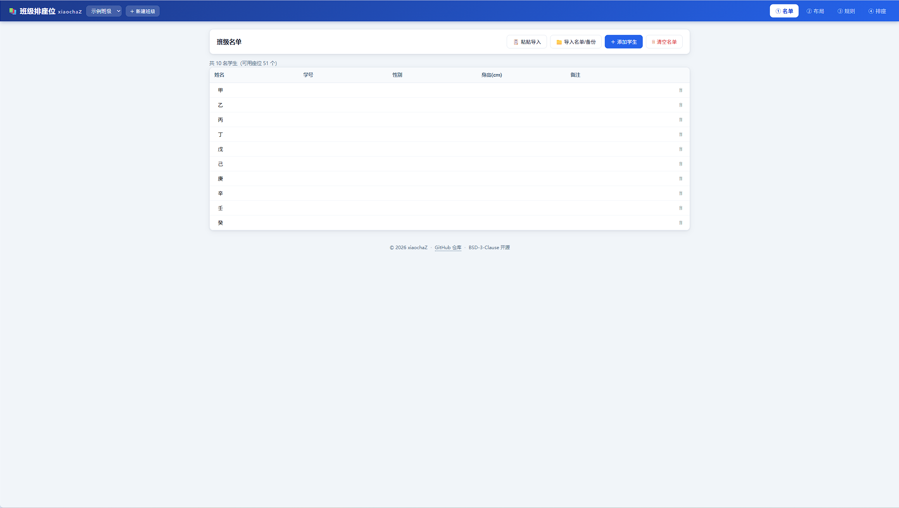
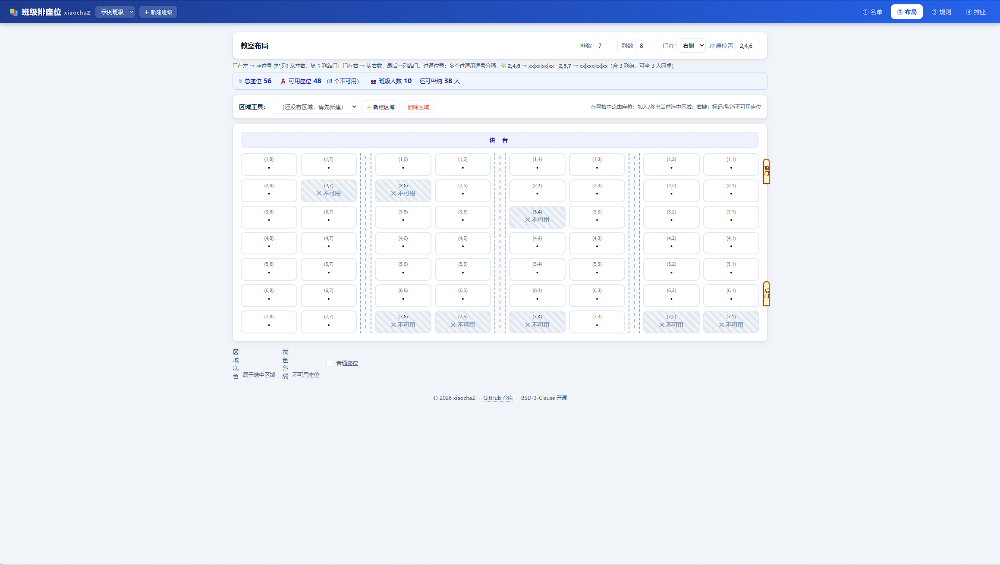
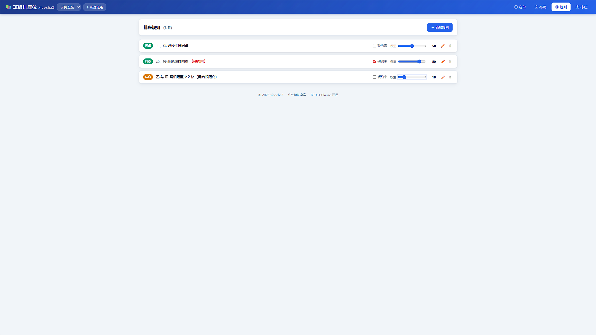
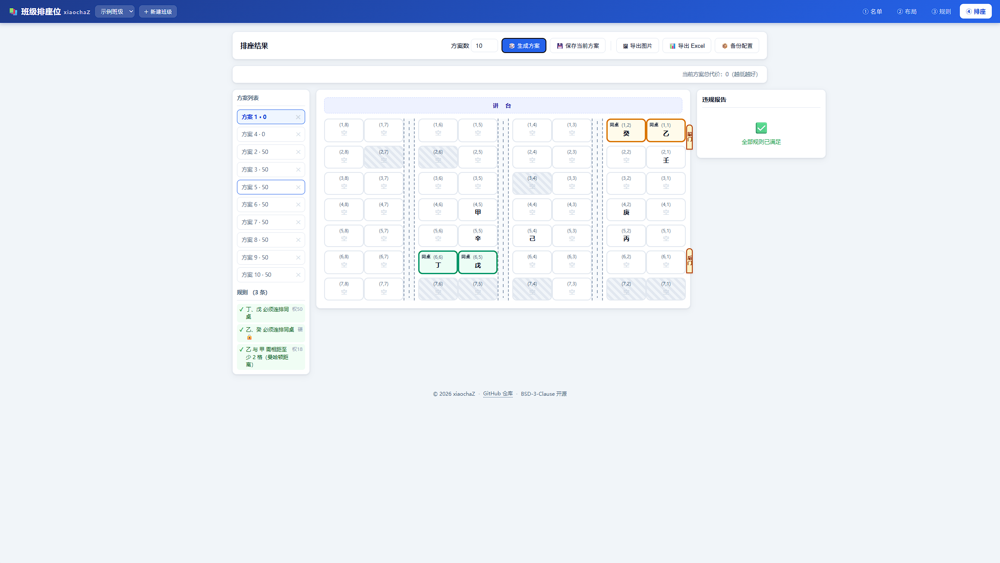

# 班级排座位软件

[](LICENSE)
[](https://github.com/xiaochaZ/seat-arranger/releases)
[](https://github.com/xiaochaZ/seat-arranger)
[](index.html)

一款给班主任用的**班级排座位 Web 工具**：导入名单 → 配置布局/规则 → 加权约束算法自动生成多套座位表 → 可视化微调 → 导出图片/Excel。

- **纯前端、零构建、零依赖**：双击 `index.html` 浏览器打开即用，无 npm、无服务器、完全离线。
- 数据存浏览器 localStorage（不上传），支持 JSON 备份/恢复。
- 支持安装为桌面应用（Chrome/Edge 菜单 → 安装为应用）。

## 界面截图

| 名单管理 | 教室布局 |
| --- | --- |
|  |  |

| 排座规则 | 排座结果 |
| --- | --- |
|  |  |

## 功能一览

- **名单**：手动添加 / 粘贴导入 / Excel(.xlsx)/CSV/文本导入（智能识别"姓名/学号/性别/身高/备注"列，表头行可不在第一行）、**勾选学生建小组**（组员随时可改，规则自动跟随）、多班级、清空名单
- **布局**：排数/列数实时调整、多过道（逗号分隔，如 `2,4,6`=xx|xx|xx|xx、`2,5,7`=xx|xxx|xx|xx 含 3 列组；**过道不计入距离**，隔过道的左右邻座算相邻 1 格）、**讲台方位（在上/在下，只影响显示，第 1 排永远靠讲台）**、门方向（左/右，座位号从门那边数）、区域框选、不可用座位（右键标记）、座位坐标 **(列,排)**（列在前、排在后，如 (3,5) = 第3列第5排）
- **规则**：同桌（2 人或 3 人连排）、隔离（不同桌 / 曼哈顿距离（过道不计入）/ **周围范围：对方前后 N 排、左右 N 座内都避开，含同桌**）、**小组（两个方向：① 保持距离——组内两两远离；② 聚在一起——组员两两同桌、座位尽量拼成矩形、整组落在同一/指定区域）**、**固定座位（锁定某同学在某座位，硬约束时会预置且拖不动）**、区域、禁坐；每条权重 0~100 + 硬约束开关
- **算法**：模拟退火 + 增量代价评估 + 聚焦扰动 + 定向修复（硬约束同桌 2/3 人可靠收敛；小组聚块枚举矩形块整组重塑）+ 硬锁定座位预置与保护；一次生成多套方案（默认 10），按总代价排序去重
- **可视化**：座位网格（区域底色/同桌同色+标签/违规红框）、**锁定座位金色虚线+🔒**、**小组成员 G1/G2 角标**、方案列表、规则满足状态列表（✓满足 / ✗未满足 / ~尽量项未达成）、违规报告（点击定位闪烁）、拖拽交换即时提示（锁定学生/锁定座位自动拦截）
- **导出**：PNG 高清图（含门/过道/同桌色）、Excel 座位表(.xlsx)、JSON 备份/恢复

## 快速上手（四步）

1. **名单**：粘贴或导入 Excel/CSV/文本，自动识别表头列；勾选学生可建「小组」（如"需要分开的 8 人"）
2. **布局**：设排数/列数/讲台方位/门位置/过道，框选区域，右键标不可用座
3. **规则**：设同桌/隔离/小组/固定座位/区域/禁坐，每条带权重（0~100）或硬约束
4. **排座**：🎲 一键生成多套方案，拖拽微调，导出 PNG/Excel

详细操作见 **[使用说明.html](使用说明.html)**。

## 技术要点

- 纯原生 JavaScript，全局 `Seat` 命名空间，按依赖顺序 `<script>` 加载（不用 ES Modules，保证 `file://` 协议可运行）
- 算法：cost.js 增量评估器 `createIncremental`（交换/空位搬移只重算涉及规则）+ anneal.js 模拟退火（T0=80/TEnd=0.5/alpha=0.992）+ 多次随机重启 + 硬锁定座位预置
- 数据模型：`layout = { rows, cols, aisles, doorSide, podiumSide, unavailable, areas }`、`groups = [{ id, name, memberIds }]`、`rules = [{ type: pair|separate|group|fixed|area|ban, mode?, ... }]`，座位 key = `r{排}c{列}`
- 违规分两档：普通违规（硬约束 → 方案判无效）与 `soft` 偏好型违规（如小组"不够紧凑"，只参与代价优化、不判失败，UI 显示为 `~` / "尽量"）
- Excel 读写：lib/xlsx.full.min.js（SheetJS 0.18.5，本地化无 CDN 依赖）

## 测试

```bash
node test/algorithm.test.js   # 算法单测 50/50
node test/bench.js            # 性能压测（50 人 + 23 条含小组/固定座位规则 + 10 套）
```

## 项目结构

```
座位表/
├── index.html              入口（四步向导：名单→布局→规则→排座）
├── css/style.css           全部样式
├── js/                     13 个功能模块（原生 JS，全局 Seat 命名空间）
├── lib/xlsx.full.min.js    SheetJS 0.18.5（Excel 读写）
├── test/                   算法单测 / 性能压测 / 工具脚本
├── 使用说明.html
```

## 开源协议

本项目基于 [BSD 3-Clause License](LICENSE) 开源，欢迎使用、修改与二次分发（保留版权声明即可）。

## 已知限制 / 后续方向

- 规则类型现有六类（同桌/隔离/小组/固定座位/区域/禁坐）；V2 还可加：性别/身高/帮扶、班干部位、按排差异化布局
- 算法对"多组 3 人硬约束同桌"和"小组聚块"都有定向修复保障，极端冲突场景会标记"未满足硬约束"
- 小组聚块只有"同桌 + 同区域"是硬要求，"拼成矩形"按"尽可能"处理（不够紧凑会提示但不判失败）
- 项目为单人单机使用；如需多人协作可后续加后端/云存储
